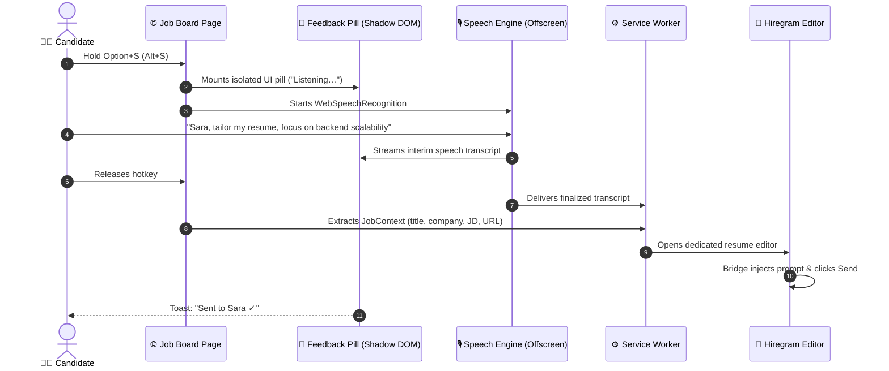
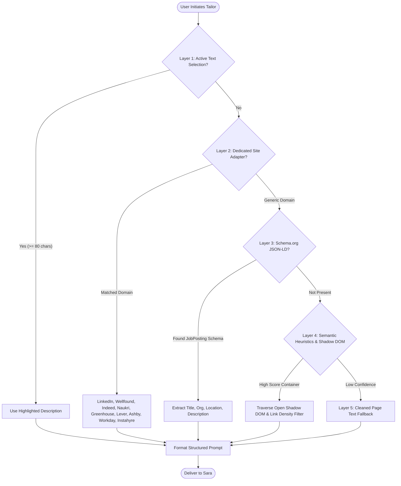

<div align="center">

  

  # Hiregram Tailor
  ### 🎙️ Instant Voice-Powered Resume Tailoring for Hiregram.ai

  [](https://github.com/djcode0718/Hiregram-sara2)
  [](https://developer.chrome.com/docs/extensions/mv3/intro/)
  [](LICENSE)
  [](tests/)
  [](extension/)

  <p align="center">
    <b>Hold <kbd>⌥ Option</kbd> + <kbd>S</kbd> &rarr; Say <i>"Sara, tailor my resume for this role"</i> &rarr; Release.</b><br>
    Hiregram Tailor extracts job specifications directly from any career board and hands them over to Sara in your Hiregram resume editor in seconds.
  </p>

  <p align="center">
    <a href="#-quick-start">Quick Start</a> •
    <a href="#-how-it-works">How It Works</a> •
    <a href="#-core-features">Features</a> •
    <a href="#-architecture">Architecture</a> •
    <a href="#-supported-job-boards">Supported Sites</a> •
    <a href="#-configuration--options">Settings</a> •
    <a href="#-troubleshooting">FAQ</a>
  </p>

</div>

---

## ⚡ Overview

Job hunting often involves repetitively copying job descriptions, switching tabs, pasting them into an AI chat composer, and asking for adjustments. 

**Hiregram Tailor** replaces this entire friction-filled loop with two effortless options:
- **🎙️ Voice Push-to-Talk:** Hold `Option+S` (`Alt+S`), speak to **Sara** (e.g. *"Sara, tailor my resume for this backend role"*), and release.
- **🖱️ 1-Click Context Menu:** Right-click anywhere on the job posting and click **"Tailor resume with Hiregram"**.

The extension cleans and extracts the job context (role, company, location, requirements), dynamically finds your default resume on Hiregram, opens its editor, and submits the tailored prompt to Sara automatically.

---

## 🚀 Quick Start

### 1. Requirements
* Google Chrome **116** or newer (macOS, Windows, or Linux).
* An active account on [Hiregram.ai](https://hiregram.ai).
* Node.js 18+ (*only needed if running tests or packaging*).

### 2. Installation (Load Unpacked)
```bash
# 1. Clone the repository
git clone https://github.com/djcode0718/Hiregram-sara2.git
cd Hiregram-sara2

# 2. (Optional) Run tests to verify everything is passing
npm test
```

1. Open Chrome and navigate to `chrome://extensions`.
2. Toggle on **Developer mode** in the top-right corner.
3. Click the **Load unpacked** button in the top-left.
4. Select the `extension/` directory inside this project repository.
5. 🎉 **Done!** The extension's Welcome & Onboarding screen will launch automatically.

---

## 🎬 How It Works

### The User Journey



---

## ✨ Core Features

### 🎙️ 1. Native Push-to-Talk Voice Interface
- **Zero Latency (~270ms start):** Hosted inside an extension-owned MV3 offscreen document using Chrome's native Web Speech API.
- **Accidental Tap Rejection:** Taps shorter than `350ms` are quietly discarded to prevent misfires.
- **Auto-Stop Safety:** Automatically releases recording after `30s` if keys are held down accidentally.
- **Keep-Alive Channel:** Dedicated messaging port prevents Chrome service worker termination during speech capture.

### 💬 2. Isolated Visual Feedback Overlay
- **CSS Isolation:** Built using a closed `Shadow DOM` attached directly to `document.documentElement`, ensuring employer site CSS never modifies or breaks the overlay.
- **Live Interim Transcripts:** View what Sara hears in real-time as you speak.
- **WCAG Compliant:** Accessible status updates via `role="status"` and `aria-live="polite"`. Respects `prefers-reduced-motion` and OS dark/light mode themes.

### 🧠 3. Smart Wake-Keyword & Intent Parser
- **Fuzzy Tolerance & Phonetics:** Matches "Sara" with a Levenshtein distance of &le; 1 and supports common STT spelling variations (`sara`, `sarah`, `sera`, `zara`, `saara`, `saira`, `cyra`, `syra`, `sora`, `surah`, `shara`, `serah`, `sehra`, `sayra`, `tara`, `saras`, `sarahs`, `sahara`).
- **Flexible Keyword Positioning:** Addresses Sara at the start (*"Sara, tailor my resume for this jd"*) or at the end (*"Tailor my resume for this jd, Sara"*), with automatic cleaning of conversational prefixes (*hey, hi, ok, okay, hello, please, can, could, would, yo*).
- **Order-Independent Semantic Matching:** Understands colloquial and varied phrasing regardless of word arrangement ("words here and there" e.g. *"Sara tailor my resume for this jd"*, *"Sara, tailor this jd to my resume"*, *"Sara, for this jd tailor my resume"*, *"Sara make my resume fit this jd"*).
- **Rich Semantic Dictionaries:** Recognizes tailoring actions (*tailor, customize, adapt, optimize, rewrite, update, fit, match, align, adjust, tune, tweak, refine, polish, revise, craft, format, sync, suit, gear, reframe, make, build, generate, create, write*), resume entities (*resume, CV, profile, bio, experience, skills, background, qualifications, credentials*), and job targets (*JD, role, position, opening, posting, vacancy, listing, company, employer, firm, screen, requirements*).
- **Accidental Voice Rejection:** Strictly filters out casual chit-chat, non-tailoring queries (e.g. *"Sara, make me a coffee"*, *"Sara, tell me a joke"*, weather, music, food orders), and bare *"Sara"* calls without instructions, guiding the candidate instead of misfiring.
- **Interim Speech Preservation:** Concatenates all final recognition segments plus trailing interim speech, ensuring words spoken right before releasing the hotkey are never truncated or lost.
- **Custom Instruction Extraction:** Recognizes explicit prompt qualifiers (e.g., *"focus on React"*, *"keep it to one page"*, *"emphasize leadership"*).

### 📄 4. Multi-Layer Job Context Extraction
The extractor evaluates five fallback layers to guarantee high-accuracy extraction (&ge; 90% success rate):



### 🎯 5. Dedicated Resume Editor Hand-off
- **Dynamic Default Resume Resolution:** Zero hardcoded IDs. Opens `https://hiregram.ai/resume`, safely inspects the list DOM for the active default resume marker (`Default · `), and smoothly navigates to its editor.
- **Background Execution & 1-Click Pill:** Opens Hiregram in the background without stealing focus from your job search. Sara prepares your tailored resume while you keep reading, with an interactive `[View in Hiregram ↗]` button on your screen to jump over whenever you are ready.
- **Decoy Immunity:** Ignores "Set as default" hover buttons, confirmation dialogs ("Make this your default?"), and hero cards to target strictly the true user-set default resume.
- **Continuous SPA Observer:** Monitors client-side route changes (`/resume` &rarr; `/resume/<uuid>`) with clean observer and timer teardown to prevent memory or CPU leaks.
- **Non-Destructive Handoff & Loop Guard:** Preserves pending handoff across reloads, guarantees idempotent single-send delivery, and prevents navigation loops if an editor redirects back to the list.
- **Dual Composer Support:** Populates `<textarea data-chat-box>` via native prototype setters and rich text container paste events, handling Hiregram's *"Pasted text · N words"* chip conversion.
- **Send Polling:** Polls the Send button every 150ms for up to 8s (handling Sara streaming/busy states) and triggers submission once enabled.

---

## 🌐 Supported Job Boards

| Platform | Extraction Strategy | Canonical Link Support |
| :--- | :--- | :---: |
| **LinkedIn** | Primary job container, strips applicant badges and recommended widgets | ✅ (`currentJobId`) |
| **Wellfound** | Full job details, salary, equity, and company profile | ✅ |
| **Indeed** | Job description container, company headers | ✅ (`jk` param) |
| **Naukri** | Body container, experience, key skills, company overview | ✅ |
| **Greenhouse** | Content body, qualifications, responsibilities | ✅ |
| **Lever** | Posting header, team/location, requirements lists | ✅ |
| **Ashby** | SSR React application container & JSON-LD payload | ✅ |
| **Workday** | Dynamic client-rendered workday job detail containers | ✅ |
| **Instahyre** | Job specification, candidate criteria, company profile | ✅ |
| **Custom Career Sites** | Open Shadow DOM search + `application/ld+json` `JobPosting` | ✅ |
| **Any Webpage** | Highlight text (&ge; 80 chars) to tailor custom job postings or email blurbs | ✅ |

---

## 🛠️ Configuration & Options

Access settings by right-clicking the extension icon &rarr; **Options** (or via `chrome://extensions` &rarr; Details &rarr; Extension options).

```
┌────────────────────────────────────────────────────────┐
│  Hiregram Tailor Settings                      v0.2.0  │
├────────────────────────────────────────────────────────┤
│  [✓] Enable Voice Extension                            │
│  [✓] Require "Sara" Keyword                            │
│  [✓] Open Hiregram in Background                       │
│  Language: [ English (India) — en-IN ▼ ]               │
│                                                        │
│  Push-to-Talk Hotkey:                                  │
│  [ ⌥ Option + S ]   [ Change Hotkey ]                  │
│                                                        │
│  Microphone Permission:                                │
│  (● Granted)        [ Grant / Test Mic ]               │
│                                                        │
│  Disabled Websites:                                    │
│  • github.com                    [Remove]              │
│  • localhost                     [Remove]              │
│                                                        │
│  Diagnostics:                                          │
│  [ Check Active Tab ]  [ Copy Debug Info ]             │
└────────────────────────────────────────────────────────┘
```

- **Custom Hotkey Recorder:** Easily rebind your shortcut (e.g., `Ctrl+Shift+U` or `Alt+J`). Modifiers (`Alt`, `Ctrl`, `Shift`, `Cmd`) are enforced.
- **Language Dialects:** Choose between `en-IN` (default), `en-US`, `en-GB`, `en-CA`, or `en-AU`.
- **Keyword Requirement:** Toggle whether the wake word "Sara" is mandatory.
- **Disabled Sites:** Prevent hotkey listeners from intercepting keypresses on code editors, spreadsheets, or specific domains.
- **Tab Diagnostics:** Verify whether content scripts are active on the current tab with a single click.

---

## 🏗️ Architecture & Project Structure

The project conforms strictly to Manifest V3 principles: **zero runtime bundlers**, **zero remote dependencies**, and **privacy-first local execution**.

```
Hiregram-sara2/
├── extension/                       # Pure extension bundle (loaded into Chrome)
│   ├── manifest.json                # MV3 manifest definition
│   ├── icons/                       # 16, 32, 48, 128px PNG icons
│   └── src/
│       ├── background/              # Background Service Worker
│       │   ├── service-worker.js    # Lifecycle orchestrator, menus, injection
│       │   ├── pipeline.js          # Voice -> Extract -> Compose -> Handoff
│       │   ├── handoff.js           # Multi-tab targeting & storage delivery
│       │   ├── extract.js           # Frame coordination & heuristic merging
│       │   └── voice-host.js        # Offscreen document manager
│       ├── content/                 # Classic IIFE Injected Scripts
│       │   ├── hotkey.js            # Capture push-to-talk keydown/keyup
│       │   ├── overlay.js           # Closed Shadow DOM UI pill
│       │   ├── extractor.js         # Self-contained DOM job parser
│       │   └── hiregram-bridge.js   # State machine bridge on hiregram.ai
│       ├── voice/                   # Offscreen Speech Recognition Host
│       │   ├── offscreen.html
│       │   ├── offscreen.js
│       │   └── voice-engine.js      # VoiceEngine & WebSpeechEngine abstraction
│       ├── pages/                   # Extension HTML Pages
│       │   ├── onboarding.html/.js  # 3-step first-run walkthrough
│       │   └── options.html/.js     # Options, hotkey recorder & diagnostics
│       └── lib/                     # Pure Functional Modules
│           ├── constants.js         # Selectors, timeouts, message types
│           ├── default-resume.js    # Pure resolver for default resume row
│           ├── wake-intent.js       # Fuzzy keyword & intent parser
│           ├── compose-message.js   # Character budgeting & safe truncation
│           ├── html-to-text.js      # HTML-to-markdown text converter
│           ├── url-utils.js         # Canonical URL & tracking parameter stripper
│           ├── settings.js          # Storage sync schema & validator
│           └── logger.js            # Privacy-safe ring buffer logger
├── docs/                            # Specifications & Documentation
│   ├── DECISIONS.md                 # Architectural decision records
│   ├── MANUAL_QA.md                 # 12+ scenario QA verification matrix
│   ├── PRIVACY.md                   # Privacy policy
│   └── STORE_LISTING.md             # Chrome Web Store submission details
├── scripts/                         # Buildless Helper Scripts
│   ├── build-content.mjs            # Inlines pure helpers into classic IIFE
│   ├── generate-icons.mjs           # Renders PNG icons from canvas
│   └── package.mjs                  # Creates dist/hiregram-tailor-0.2.0.zip
└── tests/                           # Automated Node Test Suite
    ├── unit/*.test.js               # Unit tests (bridge, intent, compose, settings)
    └── extractor/*.test.js          # JSDOM fixture tests across all 9 adapters
```

---

## 🔒 Security & Privacy

- **No Remote Scripts:** Follows Chrome Web Store guidelines; all code is bundled locally.
- **No Background Audio Eavesdropping:** The microphone is only active while the push-to-talk hotkey is physically held down. Audio tracks are immediately closed on key release.
- **Isolated Storage:** Job details are passed via `chrome.storage.local` with one-time random message tokens (`pendingId`) authorized only for the newly created tab.
- **Privacy-Safe Logs:** Internal diagnostics never record audio streams, transcripts, or personal credentials.

---

## 🧪 Developer Commands

```bash
# Run all 57 unit and extractor tests
npm test

# Run ESLint linter
npm run lint

# Generate self-contained content scripts without bundler
npm run build

# Package extension into a distribution zip
npm run package
```

---

## ❓ Troubleshooting (FAQ)

<details>
<summary><b>1. Why does the overlay say "Microphone access needed"?</b></summary>
Chrome requires microphone access to be granted once to the extension domain. Right-click the extension icon &rarr; <b>Options</b> &rarr; click <b>Grant / Test Mic</b>, or complete the 1-click prompt on the onboarding page.
</details>

<details>
<summary><b>2. Option+S doesn't do anything on an existing page.</b></summary>
If a web page was already open before installing or reloading the extension, simply refresh that tab once or open a new tab so Chrome injects the push-to-talk content script.
</details>

<details>
<summary><b>3. Why did the overlay say "Didn't hear Sara"?</b></summary>
By default, the voice parser expects commands to start with "Sara" (e.g. <i>"Sara, tailor my resume..."</i>). If you prefer speaking commands directly without a keyword, open the extension <b>Options</b> and uncheck <b>Require "Sara" Keyword</b>.
</details>

<details>
<summary><b>4. How do I tailor a job post on an unsupported or private portal?</b></summary>
Simply select/highlight the job description text with your mouse (&ge; 80 characters), then hold <kbd>Option+S</kbd>. Hiregram Tailor automatically prioritizes your highlighted text over automatic page extraction.
</details>

<details>
<summary><b>5. What happens if I say something unrelated while holding Option+S?</b></summary>
Hiregram Tailor features a semantic intent classifier. If you speak everyday conversation (e.g. <i>"Sara, make me a coffee"</i>, <i>"Sara, tell me a joke"</i>, or ask about the weather), the request is cleanly rejected with gentle on-screen feedback: <i>"I can only tailor your resume for jobs on screen"</i>, preventing accidental triggers.
</details>

---

<div align="center">
  <b>Built with ❤️ for candidates using <a href="https://hiregram.ai">Hiregram.ai</a></b>
</div>
